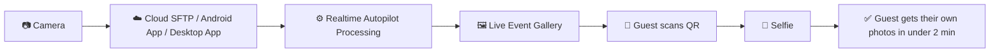

# FaceMatch Studio

### AI-Powered Realtime Event Image Sharing
**Face Based Photo Sharing & Auto Editing Suite for Photographers**

*Collect your memories of a moment, in a moment.* ✨

🤳 A selfie is all it takes to get your photos.
📸 Images from camera to guest's phone in seconds.
🎊 **We are launching!**

**Fastest · Cheapest · Reliable · Realtime AI Event Photo Sharing Platform**

 

---

## 📌 Overview

> **Connect your camera and keep shooting. Guests scan a QR code, snap a selfie and get their photos in realtime, in under 2 minutes.**

**FaceMatch Studio** connects photographers and event guests through AI face recognition. We take care of **thumbnails, presets, logo, compression and photo delivery in realtime**, so you can focus on shooting.

FaceMatch Studio is an AI-powered, realtime event photo delivery platform. Photographers shoot, we process and deliver, and guests get their photos in **under 2 minutes**. Guests never scroll through thousands of photos again: they scan, take a selfie and receive **only their own pictures**.

---

## ⚙️ How It Works

| Step | Stage | What happens |
|:----:|-------|--------------|
| **01** | 🔌 **Connect** | Link your camera via Cloud SFTP or our Android app and keep shooting. |
| **02** | 🧠 **We Process** | Thumbnails, color preset, logo, compression and AI face recognition run in realtime. |
| **03** | 📱 **Guests Scan** | Guests scan the event QR code to open the live gallery. |
| **04** | 🤳 **Selfie & Get** | A quick selfie finds every photo of them in under 2 minutes from the shot. |

---

## 👥 The Experience for Your Guests

| Step | Action | Details |
|:----:|--------|---------|
| **01** | **Scan the QR code** | Guests open the live event gallery from the QR code at your event. |
| **02** | **Take or upload a selfie** | One quick selfie lets our AI scan the whole gallery for their face. |
| **03** | **Tap "Find My Photos"** | Every photo they appear in shows up in realtime, within 2 minutes of the shot. |
| **04** | **Download & share** | Guests save their photos before the gallery expires. Returning guests just pick their name. |

**Guest gallery page includes:**
- 🎨 Photographer branding (studio logo and social links) and event name at the top
- 📷 **Take Selfie** or ⬆️ **Upload Selfie** options
- 🔍 **Find My Photos** button
- ⏳ Live countdown: *"Download your photos before: …"* (gallery expiry timer)
- 🔁 **Already searched before?** Select your name from a dropdown to instantly load matched photos without taking another selfie

---

## 🚀 How to Use: Create. Connect. Shoot. Realtime.

Three steps. Everything else runs on realtime autopilot: **shutter to guest in under 2 minutes.**

1. **Create an event**: set up your event in the dashboard.
2. **Connect your camera**: pick any one method below.
3. **Start shooting**: that's it. We handle the rest.

### 📡 Connect Your Camera

| Method | Device Needed | Transfer |
|--------|---------------|----------|
| **Cloud SFTP** | No device needed | ⚡ Realtime |
| **Android app: wired PTP** | Android phone | ⚡ Realtime |
| **Android app: FTP** | Android phone | ⚡ Realtime |
| **Desktop FTP** | Desktop app | ⚡ Realtime |
| **Manual upload** | Desktop app | 🕒 On demand |

> ℹ️ **Note (from the dashboard):** Camera SFTP direct cloud upload requires the **Cloud Image Processing add-on**. Without this add-on, use the **FaceMatch Desktop App** to process event photos. The desktop app must remain online and actively shooting for the event.

### 🤖 Realtime Autopilot: for every image, under 2 minutes

| ✅ Your logo applied | ✅ Color grading | ✅ Size compressed |
|:---:|:---:|:---:|
| **✅ Thumbnail created** | **✅ Uploaded to cloud** | **✅ Face recognition** |

---

## 🖥️ Your Dashboard

A single dashboard to run every event:

- **Welcome panel** with **+ Create New Event**
- **Current Event**: active event status, uploaded images counter (e.g. `0 / 5,000 photos`), start and end dates
- **Event Overview**: live counts of **Images**, **Faces** and **Searched**, with **View Event Images** and **Event Settings** shortcuts
- **SFTP Camera Connection**: connection details plus **Download Desktop App**
- **Image Processing Pipeline**: live counters for every stage

| Stage | Meaning |
|-------|---------|
| 🖼️ **Thumbnail** | Generating thumbnails |
| ⏳ **Queued** | Waiting for processing |
| ⚙️ **Processing** | Identifying faces |
| ☁️ **Uploading** | Uploading to cloud |
| ✅ **Done** | Ready to search |
| ❌ **Error** | Failed to process |

- **System Log**: realtime, filterable log of the cloud processing pipeline
- **All Events** view to manage every event in one place

---

## ✨ 12 Features. All in Realtime.

| # | Feature | Description |
|:-:|---------|-------------|
| 01 | 🧠 **Realtime AI Face Recognition** | Scans thousands of event photos in seconds. Guests get photos within 2 minutes. |
| 02 | 🤳 **Selfie-Powered Photo Delivery** | Guests take a selfie and get their photos in realtime, then download and share. |
| 03 | 🔄 **Realtime Camera Syncing** | Connect via Cloud SFTP or the Android app. Photos upload and process while you keep shooting. |
| 04 | 🔐 **Secure Cloud Storage** | High-resolution images are backed up, optimized and delivered without delay. |
| 05 | 🛡️ **Total Privacy Control** | Password-protected galleries plus optional 4-digit personal PINs. |
| 06 | 📲 **Scan-and-Go QR Codes** | Custom QR codes at your event open the live gallery instantly. |
| 07 | 🏷️ **Automated Brand Watermarking** | Your logo is applied to every image at the position you choose. |
| 08 | 🎨 **Instant Color Grading** | Your color presets (LUTs) are applied automatically on upload. |
| 09 | 📖 **Online Album Selection** | Clients pick their favorite images online for photo albums. |
| 10 | 👨‍👩‍👧 **Guest POV Uploads** | Guests add their own photos to a shared gallery. |
| 11 | 🔗 **Auto Personal Gallery Link** | After the event, each registered guest receives a link to their photos. |
| 12 | 🎚️ **Customizable Quality** | Tune compression or deliver full original quality images. |

---

## 🎯 Perfect For

| | | |
|:---:|:---:|:---:|
| 💍 **Weddings** | 🏢 **Corporate Events** | 🏃 **Sports & Marathons** |
| 🎶 **Festivals & Concerts** | 🎓 **College & School** | 🎂 **Parties & Birthdays** |

From intimate celebrations to large festivals, FaceMatch Studio delivers every guest their photos in realtime, in under 2 minutes.

---

## 🤝 Let's Work Together

### **Ready to deliver photos the smart way?**

| | |
|---|---|
| 🌐 **Website** | [facematchstudio.in](https://facematchstudio.in/) |
| 📸 **Instagram** | [@facematchstudio.in](https://www.instagram.com/facematchstudio.in/) |
| ✉️ **Email** | [connect@facematchstudio.in](mailto:connect@facematchstudio.in) |
| 📞 **Phone** | [+91 90231 60334](tel:+919023160334) |

---

## 🌍 Find Us Online

---

**FaceMatch Studio** · 2026
*Shutter to guest in under 2 minutes.* 📸

